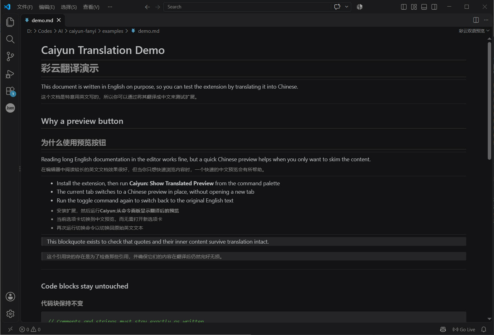

# 彩云翻译 · Markdown 预览

在 VS Code 里阅读 Markdown 时，点一下就把当前标签页切换成中文译文预览；再点一下切回原文。



- **原地切换**：同一个标签页换渲染方式（等价于「Reopen Editor With」），不新开窗口、也不关闭任何标签
- 默认方向是 **英文 → 中文**（`en2zh`），也可以在设置里改成中文译出等方向
- 只翻译正文，**代码块、行内代码、URL、HTML 标签原样保留**
- Markdown 结构（标题层级、列表、表格、引用、加粗、链接）不会被破坏
- **渲染直接复用 VS Code 内置的 Markdown 渲染器**，输出与原生预览逐字一致，自带代码高亮和 KaTeX 数学公式
- 已是中文的段落不会被重复翻译
- **边翻边显示**：每翻完一批就立刻渲染，不用等全文
- 翻译前后可一键来回切换，**不会修改你的源文件**
- Token 存放在 VS Code 的加密存储（`SecretStorage`）中

## 安装

```bash
npm install
npm run package          # 生成 caiyun-fanyi-0.1.0.vsix
code --install-extension caiyun-fanyi-0.1.0.vsix
```

安装后需要 `Developer: Reload Window`（重载窗口）才生效。

### 开发调试

用 VS Code 打开本目录，按 `F5` 启动「扩展开发宿主」窗口，在里面打开任意 `.md` 文件测试。改代码前先 `npm run watch`，然后 `Ctrl+R` 重载宿主窗口。

## 首次配置

1. `Ctrl+Shift+P` → **彩云翻译: 设置 API Token**
2. 粘贴 Token 回车，加密保存

也可以填设置项 `caiyunFanyi.token`，但推荐用上面的命令（不会在 `settings.json` 里留明文）。

## 使用

打开任意 Markdown 文件，然后：

| 方式 | 操作 |
|---|---|
| 命令面板 | `Ctrl+Shift+P` → **彩云翻译: 切换译文 / 原文预览**（来回切换） |
| 命令面板 | `Ctrl+Shift+P` → **彩云翻译: 显示译文预览**（只切到译文） |
| 命令面板 | `Ctrl+Shift+P` → **彩云翻译: 显示双语预览**（原文 + 译文对照） |
| 编辑器 `...` 菜单 | 显示译文预览 / 显示双语预览 / 恢复原文预览 |
| 编辑器右键 → **Reopen With** | 选 **彩云译文预览** 或 **彩云双语预览** |
| 资源管理器右键 | 对 `.md` 文件选择 **显示译文预览** |

## 两种视图

| 视图 | 长什么样 |
|---|---|
| **彩云译文预览** | 只显示中文译文，沉浸阅读 |
| **彩云双语预览** | **逐段对照**：每段原文在上、译文紧接在下，段与段之间用细线分隔 |

点击后：

- **在当前标签页里**把编辑器切换成译文预览（等价于「Reopen Editor With」，同一个 URI 只换 viewType），不新开标签
- 先立刻显示原文，随后**每翻完一批就替换一批** —— 你看到多少就是翻好了多少，后台继续往下翻
- 翻译进度显示在 VS Code 底部状态条的窗口级进度里，不影响阅读
- 全部翻完才算完成，中途关掉标签取消，已翻好的部分不会进缓存（下次还会重翻）
- 想切回原文，再执行一次 **切换译文 / 原文预览**（回到你切换前的形态：编辑器或内置预览）

切换前后的效果：

```
demo.md（文本编辑器）  ──切换译文 / 原文预览──▶  demo.md（译文预览）
                        ◀──再来一次─────────────
```

注意：标签页标题始终是 `demo.md`，不会变成另一个文件。

> 本扩展不注册任何默认快捷键，避免和你的键位冲突。想加快捷键的话，在「键盘快捷方式」里搜索 `caiyunFanyi.toggleTranslatedPreview` 自行绑定即可。

## 译文缓存

翻译结果缓存在扩展宿主内存里，**不写磁盘**：

| 事件 | 缓存 |
|---|---|
| 关闭译文标签 | 保留（再打开直接秒出） |
| 改了文档内容 / 换了翻译方向 | 失效，需重新翻译 |
| 重载窗口 / 关闭 VS Code | 清空 |

所以来回切换「译文 ↔ 原文」不会重复消耗额度。

## 设置项

| 设置 | 默认值 | 说明 |
|---|---|---|
| `caiyunFanyi.token` | `""` | Token 兜底位置，优先使用加密存储里的值 |
| `caiyunFanyi.transType` | `en2zh` | 翻译方向，见下表 |
| `caiyunFanyi.endpoint` | `https://api.interpreter.caiyunai.com/v1/translator` | 接口地址，官方调整时可改 |
| `caiyunFanyi.batchSize` | `8` | 每批请求的文本段数，太大可能触发限流 |

支持的翻译方向（取自官方文档，`auto2xx` 会自动识别源语言）：

| 方向 | 含义 |
|---|---|
| `en2zh` | 英文 → 中文（默认） |
| `en2zh-Hant` | 英文 → 繁体中文 |
| `auto2zh` | 自动识别 → 中文 |
| `zh2en` / `auto2en` | 中文 → 英文 |
| `zh2ja` / `zh2ko` | 中文 → 日文 / 韩文 |
| `zh2zh-Hant` | 中文 → 繁体中文 |
| `ja2zh` / `ko2zh` | 日文 / 韩文 → 中文 |
| `de2zh` / `fr2zh` / `ru2zh` | 德 / 法 / 俄 → 中文 |

方向不只是影响接口参数，还决定「哪些行算正文」：`en2zh` 只挑含拉丁字母的行，`zh2en` 只挑含中文的行，所以中英混排的文档不会把已有的中文再翻一遍。

## 实现要点

**为什么不能把按钮直接放进预览页面里？** 内置 Markdown 预览是 VS Code 自身扩展创建的 webview，第三方扩展拿不到它的消息通道；而且它的 CSP 里 `connect-src` 回落到 `default-src 'none'`，就算通过 `markdown.previewScripts` 注入脚本，也没法发网络请求。所以在页面内部做「按钮 + 调 API + 改 DOM」这条路是堵死的。

**实际做法：虚拟文档 + 原生预览。**

1. 命令注册成虚拟文档提供器（scheme `caiyun-fanyi-translated`）
2. 点击按钮 → 保护式翻译源 Markdown → 把译文作为虚拟文档内容发布
3. 调 `markdown.showPreview`，VS Code 用**自己的**渲染管线渲染这份虚拟文档，并原地替换当前预览

**保护式翻译**（`src/markdownTranslator.ts`）是质量关键：

- 用状态机跳过围栏代码块
- 剥离行首结构前缀（`#`、`-`、`>`、`1.`、缩进）后单独翻译正文
- 行内代码、图片、HTML 标签、自动链接、**整条行内链接**、强调标记，全部替换成 `XQnQX` 占位符，翻译后再还原
- 链接文字拆成独立任务单独翻译，引擎完全看不到方括号 + 圆括号的链接语法
- 强调标记按出现顺序配对成开 / 闭标记。引擎会在占位符两边补空格，还原时让开标记吃掉右侧空格、闭标记吃掉左侧空格，保证 `**` 和它包裹的文字紧贴 —— 否则会得到 `** sample **` 这种前后带空格的写法，CommonMark 根本不会把它渲染成粗体
- 译文逐行校验：占位符数量与序号必须一致，且不能残留中文，否则该行保留原文 —— 宁可少翻，也不能把 Markdown 语法搞坏

**占位符形式是实测算出来的**，这点踩过坑：

| 形式 | 存活率 | 备注 |
|---|---|---|
| `⟦n⟧` | ✗ | 被替换成 `⁇`，直接丢字符 |
| `{{n}}` | 5/6 | 紧贴中文时会丢一个花括号 |
| `((n))` | 3/6 | 被当成普通括号 |
| 方括号 / 段落符 / 双波浪线形式 | ✗ | 被拆开或吃掉 |
| **`XQnQX`** | **6/6** | 伪英文单词，引擎当专有名词原样保留 |

另外 `**` 一定不能被引擎看到，它会被拆成 `* *`，所以强调标记也必须一起遮罩。

## 已知限制

- **不渲染 Mermaid**：本扩展只负责翻译，为了保持轻量没有引入图表渲染库。需要看图的话，按 `Ctrl+Shift+V` 切回 VS Code 原生预览即可
- **数学公式能用但不完美**：渲染结果来自内置渲染器（KaTeX 的 HTML 已生成），但没打包 KaTeX 的 CSS 和字体，公式排版不如原生预览精致。重要公式建议切原生预览看
- **图片可能显示不出来**：相对路径基于源文件目录解析，跨目录引用（`../`）可能被局部资源限制挡住
- 渲染依赖内置扩展 `vscode.markdown-language-features`（VS Code 自带，默认启用）；被禁用时会退化成纯文本显示
- 一次翻译整篇文档，超长文档会分多批串行请求
- 表格单元格逐行翻译，长表格的语感可能不如整段
- 段落内部被代码/链接切碎的句子，语序会受分段影响
- 需要能访问彩云接口；公司代理环境请确认 `http.proxy` 对扩展宿主生效

## 自检脚本

离线测试（不需要 Token、不联网）：

```bash
npm test
```

| 脚本 | 覆盖 |
|---|---|
| `scripts/markdown-check.mjs` | 结构保护、占位符还原、不安全译文拦截、双向（中英） |
| `scripts/translator-check.mjs` | 请求格式、分批、增量回调、重试、取消（本地假服务器） |
| `scripts/stream-check.mjs` | 流式渲染：每批完成后内容确实在变、行数不变 |

集成测试（在真实 VS Code 里跑，验证标签页行为）：

```bash
npm run test:integration
```

会先构建，再下载一个独立的 VS Code 测试实例（`.vscode-test/`，约 200MB，只下一次），覆盖：

- 五个命令都已注册
- 不注册默认快捷键
- **切换译文后标签数量不变**（原地替换，不新开）
- 切回编辑器同样原地
- **切换双语视图同样原地**
- 双语视图切回编辑器同样原地

> `.vscode-test/` 和 `test/` 都不会打包进 VSIX，已在 `.vscodeignore` 里排除。

真实接口验证（会消耗额度，需要自己的 Token）：

```bash
# PowerShell
$env:CAIYUN_TOKEN = "你的 token"; node scripts/live-check.mjs
# bash
CAIYUN_TOKEN=你的token node scripts/live-check.mjs
```

`scripts/probe-placeholder.mjs` 是当时用来测占位符存活率的探测脚本，可作为以后更换翻译引擎的参考。
